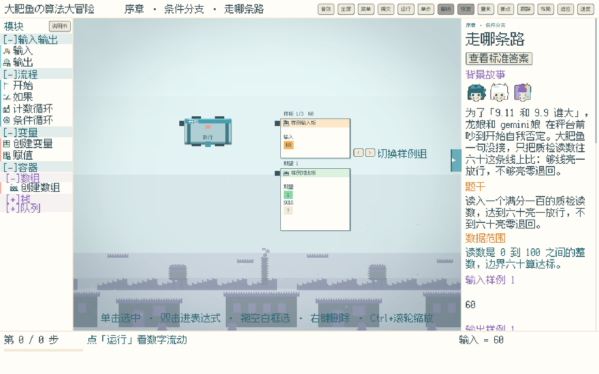
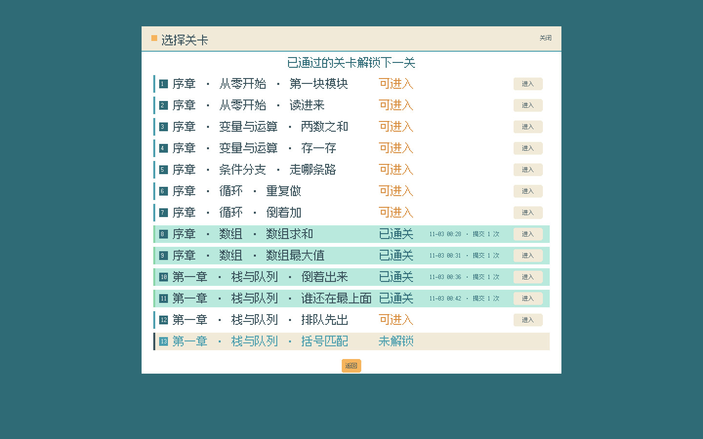

# 大肥鱼の算法大冒险 · dayu-algo

把 C++ 算法题画成节点图：拖模块、连线、双击写表达式，一条主链自上而下读下来就是 `main`。做完点「运行」，样例板和隐藏抽查都过了才算通关。

Unity 6 实现。场景文件 `Assets/Scenes/Main.unity` 里只有 `App` 和 `EventSystem` 两个物体，其余界面全是运行时用代码装配的像素风 UI，没有预制体；贴图来自 `Resources/` 下的像素素材（第三方立绘与背景 + 本项目自绘的道具与图标）。

**[下载 Windows 试玩包](https://github.com/mngli-ai/dayu-algo/releases/latest)** · [更新日志](https://github.com/mngli-ai/dayu-algo/releases) — 解压后运行 `dayu.exe`，无需安装。



## 玩法

一关给你半张图：起始模块和两块样例板（样例输入板 / 样例对比板）已经摆好且常驻、删不掉，缺的部分自己补。

| 交互 | 说明 |
| --- | --- |
| 左侧模块栏 | 按章节分组的节点目录，拖到画布上就多一个卡片 |
| 连线 | 从底部端口拖到下一个节点顶部；分支节点有 `true` / `false` 两路，循环节点有 `body` 和 `done` |
| 双击卡片 | 弹出浮窗编辑参数，表达式（`sum + a[i]`、`s[i]`、`c == '('`）都写在这里 |
| 运行 / 单步 / 断点 / 跟踪 | 顶栏按钮，配合变量面板看每一步的值 |
| 样例对比板 | 自动拿运行结果和期望输出比对，不一致就标红 |
| 提交 | 除可见样例外还会跑隐藏抽查用例，全过才解锁下一关 |
| 说明书 | 顶栏「说明书」随时打开：31 条模块条目 + 30 条操作条目，按 7 个分组翻页，还能跳到对应模块 |
| 判题反馈 | 单条样例过了撒彩带、整关通过放烟花、答案错了画红叉，每个结论都配一条程序化音效 |
| 查看标准答案 | 右侧题栏随时打开预览。预览只读：不能提交，也不能复制粘贴——想抄就得先退出预览回到自己的图 |

两块样例板（样例输入板 / 样例对比板）常驻画布，删不掉也不需要自己摆。

容器有专门的可视化：数组是列车车厢，栈是一口竖直的筒，队列是排队通道；压入弹出会跟着执行链播动画。

## 关卡

共 13 关，分两个章节。

- **序章 · 从零开始** —— 第一块模块、读进来
- **序章 · 变量与运算** —— 两数之和
- **序章 · 条件分支** —— 走哪条路
- **序章 · 循环** —— 重复做、倒着加
- **序章 · 数组** —— 存一存、数组求和、数组最大值
- **第一章 · 栈与队列** —— 倒着出来、谁还在最上面、排队先出、括号匹配

题目正文、故事、数据范围、提示、标准答案图和测试用例全部写在 `Assets/Scripts/Core/Levels.cs`，加关卡就是加一个 `new Level{...}`。




## 代码结构

| 路径 | 内容 |
| --- | --- |
| `Assets/Scripts/Core/` | 图数据模型（`Graph` / `NodeTypes`）、表达式语言与类型检查（`ExprLang`）、编译器（`Compiler`）、虚拟机（`Vm`）、追踪（`Trace`）、C++ 代码生成（`CppGen`）、关卡（`Levels`） |
| `Assets/Scripts/GraphView/` | 画布、卡片形状绘制、撤销重做历史 |
| `Assets/Scripts/UI/` | 像素 UI 组件（按钮、输入框、位图文本、面板）、模块栏、检查器、变量浮窗、数组/栈/队列看板、顶栏、存档 |
| `Assets/Scripts/Art/` | 贴图的加载与切帧（主角、模块图标、道具、精灵动画） |
| `Assets/Scripts/Text/` | 位图字形图集 |
| `Assets/Editor/` | 自测入口（`Cli.RunSelfTests`）、命令行打包（`BuildCli.BuildWindows`）、26 个测试类 |

约 3.1 万行 C#。

## 构建与运行

需要 Unity **6000.3.25f1**（Build Target: Windows x64）。

编辑器里跑：Unity Hub 添加本目录，打开 `Assets/Scenes/Main.unity`，点 Play。场景里只有一个空物体，界面由 `App` 在运行时搭出来。

命令行自测（编译每关标准答案，再用测试用例跑 VM）：

```bat
"C:\Unity\6000.3.25f1\Editor\Unity.exe" -batchmode -quit ^
  -projectPath <本项目路径> ^
  -executeMethod Dayu.EditorTools.Cli.RunSelfTests ^
  -logFile -
```

命令行打包：

```bat
"C:\Unity\6000.3.25f1\Editor\Unity.exe" -batchmode -quit ^
  -projectPath <本项目路径> ^
  -executeMethod Dayu.EditorTools.BuildCli.BuildWindows ^
  -logFile -
```

产物在 `Build/dayu.exe`。

单个测试类也能单独跑，例如 `-executeMethod Dayu.EditorTools.ExprLangTests.RunAll`，断言失败时进程退出码为 1。

## 仓库说明

不入库的目录：`Library/`、`Build/`、`Logs/`、`Evidence/`（逐轮验收截图与日志）、`UserSettings/`、`ArtInbox/` 下的第三方素材原包。`ArtInbox/SOURCES.md` 和随附的 NOTICE 保留在仓库里，作为素材授权台账。

Windows 试玩包在 Releases 里下载，解压直接运行 `dayu.exe`。

## 授权与署名

游戏里的画面分四路来源，逐文件的来源页、许可证原文位置、派生参数都在 `ArtInbox/SOURCES.md`，游戏实际用到的产物清单在 `docs/art-assets-manifest.md`。

**主角「溟月」**——第三方二创素材，**CC BY-NC-SA 4.0**，署名链：

1. 上善无形 —— 溟月原型（pixiv 62155430）
2. ZipZipPipe —— 女仆鲸鱼娘设计（pixiv 18604994）
3. Small-tailqwq —— 三创再设计（https://github.com/Small-tailqwq/dsh-deep-whale）

动画帧另有 ④ FAYER-0610（分层与转发）⑤ PC2005-cloud（dsh-pet 桌宠原作者）。

**各家 AI 拟人立绘**（主菜单舞台、出场名单、题栏头像，`Assets/Resources/Personas/` 24 张）——画师 **ZipZipPipe** 的《AI娘化》系列同人成图（pixiv 148186519 与 bilibili《大AI和小AI们》BV1tE9XBbErS 截帧），经已逐项登记许可的收录仓库 `shuaizenge/ai-girls` 原字节取回。作者开放分享、允许再创作，但**不授予标准许可证**，其中 DeepSeek 二次设计明确 CC BY-NC-SA 4.0 → 只可用于非商业项目。项目内只做抠白底 / 裁切 / 降采样，未画一笔角色本身。

**画布动态背景**（`Assets/Resources/Backdrop/` 五层，576×324 真像素）——**CraftPix.net**《Underwater World Pixel Background》，许可证 **OGA-BY 3.0**（署名 CraftPix.net，允许商用与再分发），来源页 https://opengameart.org/content/underwater-world-pixel-background 。原字节拷贝，未修改。

**中文字形**——画面里的每个汉字都是位图图集 `Assets/Resources/atlas.png`，图集由工具期调用第三方像素字体 **TakWolf《Fusion Pixel Font》**（`Assets/Art/Font/fusion-pixel-12px.ttf`）栅格化生成，许可证 **SIL Open Font License 1.1**，原文已入库为 `docs/licenses/fusion-pixel-12px-OFL.txt`。字体本体不进玩家包，玩家包内只有生成的位图。

**本项目自绘 / 自产**：道具、车厢、箱体、模块小图标、彩带与特效、全部音效（`tools/gen_sfx.py` 合成，无第三方音源），以及「大肥鱼」这一只主角像素形象（原创演绎，不基于任何第三方成图）。

由于包含 NC 与 NC-SA 素材，本仓库整体按非商业用途发布：转载、二创需署名上述作者链，并以相同方式共享。代码部分未单独声明开源许可。**要商用必须先换掉主角与各家拟人形象**（背景与字体这两路本身可商用）。
